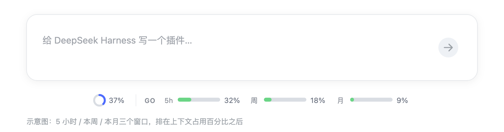
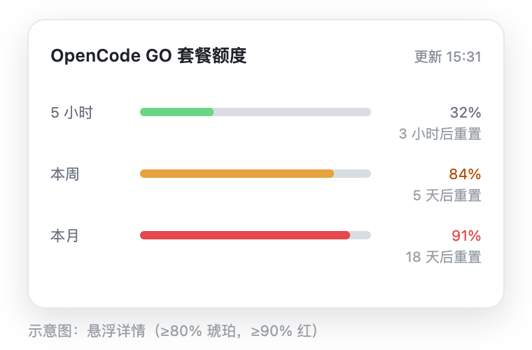

# dsh-go-quota

English | [简体中文](README.md)

A [DeepSeek Harness](https://github.com/deepseek-ai/deepseek-harness) plugin that keeps the
**OpenCode GO** quota for the **5-hour / weekly / monthly** windows visible right below the
chat composer: label + mini progress bar + percentage, with reset countdowns on hover and
click-to-refresh.

<p align="center">
  
</p>

<p align="center">
  
</p>

> Illustrations only; the real UI follows the active DSH theme.

## Features

- All three windows at a glance, no settings page, no OpenCode dashboard.
- Full-width track = 100%; used portion fills proportionally, the rest stays gray.
- Threshold colors: green `#6bd586` below 80%, amber at ≥80%, red at ≥90%.
- Reads the API key **only from the current DSH configuration**: no `auth.json`, no
  environment-variable scraping, and the key never reaches the browser.
- Zero runtime dependencies: no zod, no native modules.
- Hidden automatically when the current model does not use the `opencode-go` provider.

## Requirements

- DSH `>= 0.2.1-rc.2 < 0.3.0` (desktop app or `dsh web`).
- Node `>= 18` (the desktop app bundles Node 24).
- An OpenCode GO subscription.

## Install

### In the DSH desktop app (GUI, recommended)

1. Open the DSH desktop app and go to the plugin manager (Settings → Plugins).
2. Click “Add plugin” and paste either source:
   ```
   dsh-go-quota                  # npm package (recommended)
   github:skyrocks/dsh-go-quota  # GitHub default branch
   ```
3. Confirm and wait for dependency resolution.
4. **Fully quit and relaunch DSH** (Cmd+Q on macOS; quit from the tray on Windows).
   Closing the window is not enough — host plugins load only at startup.
5. Pick a model that uses the `opencode-go` provider. The dock should appear below
   the composer: `GO 5h … · week … · month …`.

### Other sources

Use the same “Add plugin” dialog with a different value:

| Source | Paste | When |
| --- | --- | --- |
| npm | `dsh-go-quota` | Normal installs, traceable versions |
| GitHub | `github:skyrocks/dsh-go-quota` | Track the default branch |
| tarball | absolute path to `dsh-go-quota-0.1.7.tgz` | Pinned versions, sharing |
| local directory | absolute path to the checkout | Development (`link:` symlink) |

On Windows, use `file:C:\path\to\dsh-go-quota` for directory installs to avoid
pnpm's `link:` drive-letter issue. Relative paths and `~` are rejected.

### CLI (optional)

```sh
dsh plugin --profile desktop add dsh-go-quota
dsh plugin --profile desktop add github:skyrocks/dsh-go-quota
dsh plugin --profile desktop add /absolute/path/to/dsh-go-quota-0.1.7.tgz
dsh plugin --profile desktop add /absolute/path/to/dsh-go-quota
```

Use `--profile web` for a `dsh web` profile. Fully quit and relaunch DSH afterwards.

### Windows

The plugin is platform-neutral (no `process.platform` branches, no native modules,
no shell scripts). Prefer the tarball; for a directory use the `file:` prefix.

## Configuration

Override the defaults in `~/.dsh/profiles/desktop/cordis.patch.yml`:

```yaml
- id: go-quota
  config:
    baseUrl: https://opencode.ai/zen/go/v1/usage
    timeoutMs: 15000
    cacheMs: 45000
```

| Field | Default | Description |
| --- | --- | --- |
| `baseUrl` | `https://opencode.ai/zen/go/v1/usage` | Usage endpoint |
| `timeoutMs` | `15000` | Per-request timeout |
| `cacheMs` | `45000` | Host-side cache; `refresh()` bypasses it |

Restart DSH after changing configuration.

## How it works

The plugin has two halves:

- **Host (`index.js`)**: resolves the `opencode-go` credential reference from DSH settings,
  resolves the secret through `ctx.credentials`, calls the usage endpoint with a Bearer token,
  normalizes the three windows, and caches the result for 45 seconds.
- **Client (`client.js`)**: a lazy-CJS bundle that mounts a Typert Remote and registers a
  `conversation.composer.dock` slot entry. It polls every 5 minutes and refreshes on click.

Key resolution, in order:

1. The `opencode-go` settings entry: `apiKeyEnv`, then `accounts[].apiKeyEnv`.
2. The `llm-pi-ai` entry: `providers["opencode-go"].apiKeyEnv`.

Each reference is resolved through `ctx.credentials.resolve()`. The result contains only
percentages and the credential **reference name** — never the key itself.

Error codes: `no-config`, `no-key`, `unauthorized` (401), `no-subscription` (403),
`network`, `bad-json`, `empty`, `http-<code>`.

## Display rules

- Provider is `opencode-go`: always visible.
- Any other provider: hidden.
- Provider unknown: visible (fail-open).
- Hover: three windows with reset countdowns. Click / Enter / Space: refresh.
- Position: last item in the composer dock, after the context-usage percentage.

## Compatibility

- Tested with DSH 0.2.1-rc.2 on macOS.
- DSH 0.1.x is not supported; 0.3.x is rejected by `engines.dsh` (override at your own risk).
- macOS tested; Windows instructions provided; Linux expected to work.

## Troubleshooting

| Symptom | Fix |
| --- | --- |
| Not visible | Fully restart DSH; check that `dsh-go-quota` is in the profile's `dsh.profile.bundles` |
| “未配置” / not configured | Configure the GO provider in Settings → Models, or the `llm-pi-ai` entry |
| 401 | The API key is invalid |
| 403 | The account has no GO subscription |
| Network error | Check proxy/firewall, or override `baseUrl` |
| Empty bars in the tooltip | Upgrade to 0.1.4+ |
| Windows install fails | Use the tarball or `file:C:\...` |

## Development

```sh
node test/smoke.mjs
node --check client.js
pnpm pack
```

The test suite covers response normalization, credential-reference collection, the Typert
codec, and a CSS regression guard. CI runs it on Ubuntu, macOS and Windows with Node 22 and 24.

## Privacy

- The key stays in the Host process; the browser only receives percentages.
- The only outbound request is the configured usage endpoint.
- No session logs are read, no telemetry is collected.

## Known limitations

- The official API only exposes account-level percentages, not per-model or per-device usage.
- Percentages only; no remaining-dollar estimates.
- Five-minute polling; click to refresh.

## License

[MIT](LICENSE)

Unofficial plugin, not affiliated with DeepSeek or OpenCode. The usage endpoint is
undocumented and may change at any time.
