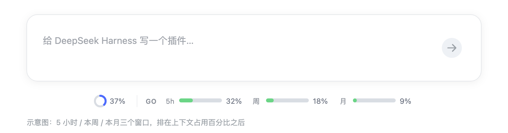
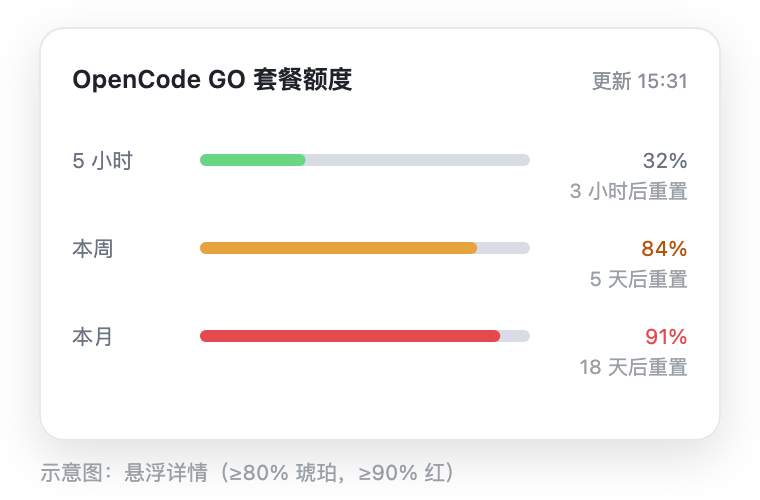

# dsh-go-quota

[English](README.en.md) | 简体中文

在 **DeepSeek Harness** 的对话输入框下方，常驻显示 **OpenCode GO 套餐**的
**5 小时 / 本周 / 本月**三个额度窗口：标签 + 迷你进度条 + 百分比，悬浮看重置倒计时，点击立即刷新。


<p align="center">
  
</p>

<p align="center">
  
</p>

> 以上为界面示意图，实际样式跟随 DSH 主题（明 / 暗）。

---

## 为什么用它

- **一眼看完三个窗口**：不用打开设置页，也不用切到 OpenCode 官网。
- **进度条 + 百分比**：整条轨道代表 100%，已用部分按比例填充，剩余部分是灰色。
- **阈值变色**：`<80%` 绿（`#6bd586`）、`≥80%` 琥珀、`≥90%` 红。
- **只读当前 DSH 配置里的 Key**：不读 `auth.json`，不扫描无关环境变量，Key 永远不进浏览器。
- **零运行时依赖**：没有 zod、没有原生模块，目录直装也不会缺包。
- **不干扰非 GO 模型**：当前会话的 provider 不是 `opencode-go` 时整条隐藏。

---

## 环境要求

| 项 | 要求 |
| --- | --- |
| DSH | `>= 0.2.1-rc.2 < 0.3.0`（桌面版与 `dsh web` 均可） |
| Node | `>= 18`（桌面版内置 Node 24） |
| 订阅 | 一个可用的 OpenCode GO 账户 |
| 系统 | macOS 已验证；Windows 见 [Windows 说明](#windows)；Linux 预期可用 |

---

## 安装

### 在 DSH 桌面端安装（图形界面，推荐）

1. 打开 DSH 桌面端，进入插件管理页（设置 →「插件」）。
2. 点「添加插件」，在弹窗里粘贴：
   ```
   github:skyrocks/dsh-go-quota
   ```
3. 确认安装，等待依赖解析完成。
4. **完全退出 DSH 再重新打开**（macOS 用 `Cmd+Q`；Windows 从托盘退出）。
   只关窗口不够——Host 插件只在启动时加载。
5. 在对话里选择一个 `opencode-go` 的模型，输入框下方会出现
   `GO 5h … · 周 … · 月 …`。如果没出现，见[常见问题](#常见问题)。

安装完成后，插件列表里会显示 `dsh-go-quota`（插件行 id 为 `go-quota`）。

### 其他安装来源

同样在「添加插件」弹窗里操作，只是粘贴的内容不同：

| 来源 | 粘贴内容 | 适用场景 |
| --- | --- | --- |
| GitHub | `github:skyrocks/dsh-go-quota` | 日常安装，跟随默认分支 |
| tarball | tarball 的**绝对路径**，如 `/Users/you/Downloads/dsh-go-quota-0.1.6.tgz` | 固定版本、分发给别人 |
| 本地目录 | 目录的**绝对路径**，如 `/Users/you/dsh-go-quota` | 开发调试（`link:` 符号链接） |

Windows 的目录安装请写成 `file:C:\Users\you\dsh-go-quota`，避免 pnpm `link:` 的盘符问题。
`~` 和相对路径会被安装器拒绝。

### 从命令行安装（可选）

如果你习惯终端，CLI 和弹窗等价：

```sh
# GitHub
dsh plugin --profile desktop add github:skyrocks/dsh-go-quota

# tarball
dsh plugin --profile desktop add /absolute/path/to/dsh-go-quota-0.1.6.tgz

# 本地目录（开发）
dsh plugin --profile desktop add /absolute/path/to/dsh-go-quota
```

> `desktop` 是桌面版 profile；如果你用的是 `dsh web`，换成 `--profile web`。
> 安装完成后同样要**完全退出并重启 DSH**。

### Windows

插件本身跨平台：纯 ESM + 浏览器 bundle，没有 `process.platform` 分支、没有原生模块，
`fetch` / `AbortSignal.timeout` 由 Node 自带。

- 推荐用 **tarball**，弹窗粘贴 `C:\Users\you\Downloads\dsh-go-quota-0.1.6.tgz`。
- 目录安装请用 `file:C:\...`；pnpm 的 `link:` 目录依赖在 Windows 上有盘符问题。
- 路径必须是绝对路径。
- 装完同样要完全退出并重启 DSH。

---

## 配置

包内 `cordis.patch.yml` 已带默认值，通常不需要改。需要覆盖时，在
`~/.dsh/profiles/desktop/cordis.patch.yml`（用户层）写入同 id 的配置：

```yaml
- id: go-quota
  config:
    baseUrl: https://opencode.ai/zen/go/v1/usage
    timeoutMs: 15000   # 单次请求超时（毫秒）
    cacheMs: 45000     # Host 侧缓存（毫秒）；点击刷新会绕过
```

| 字段 | 默认值 | 说明 |
| --- | --- | --- |
| `baseUrl` | `https://opencode.ai/zen/go/v1/usage` | 用量接口地址 |
| `timeoutMs` | `15000` | 请求超时 |
| `cacheMs` | `45000` | Host 缓存时长；`refresh()` 忽略缓存 |

改完配置需要重启 DSH。

---

## 工作原理

```
┌──────────────────────── 浏览器（Web GUI）────────────────────────┐
│ client.js                                                        │
│  ├─ ctx.remote.$mount({ package, descriptors })                  │
│  ├─ slots.register("conversation.composer.dock", Dock)           │
│  └─ Dock：每 5 分钟 read()，点击时 refresh()                      │
│                              │ Typert RPC（/api）                 │
└──────────────────────────────┼───────────────────────────────────┘
                               ▼
┌──────────────────────── Host（Node）─────────────────────────────┐
│ index.js  GoQuotaGateway extends TypertRemoteService             │
│  ├─ 从 DSH 配置解析 opencode-go 的凭据引用                        │
│  ├─ ctx.credentials.resolve(ref) 取得 Key（只在 Host 内存）        │
│  ├─ GET baseUrl（Bearer，超时 + 一次重试）                         │
│  ├─ normalize：rolling / weekly / monthly                         │
│  └─ 45s 缓存 + 并发去重                                           │
│                              │                                    │
│                              ▼                                    │
│              https://opencode.ai/zen/go/v1/usage                  │
└───────────────────────────────────────────────────────────────────┘
```

### Key 从哪来

严格只读**当前 DSH 配置**，按以下顺序取第一个可解析的凭据引用：

1. `settings.describe()` 中 id 为 `opencode-go` 的插件条目：`apiKeyEnv`，再退到 `accounts[].apiKeyEnv`；
2. `settings.describe()` 中 `llm-pi-ai` 条目的 `providers["opencode-go"].apiKeyEnv`。

每个引用交给 `ctx.credentials.resolve()` 解析；**不读** `~/.local/share/opencode/auth.json`，
**不扫描**无关环境变量。解析结果中的 `keyRef` 只是变量名（用于排查），不会返回 Key 本身。

### 接口与错误

- 请求：`GET {baseUrl}`，`Authorization: Bearer <key>`，`Accept: application/json`。
- 兼容 `{ usage: {...} }` 包裹与平铺两种响应，窗口字段支持 `percent` / `used_percent`、`resetsAt` / `resets_at`。
- 错误映射：

| 错误码 | 含义 |
| --- | --- |
| `no-config` | DSH 配置里找不到 `opencode-go` 的 `apiKeyEnv` |
| `no-key` | 找到了引用，但 `ctx.credentials` 里没有值 |
| `unauthorized` | 401，Key 失效 |
| `no-subscription` | 403，账户没有 GO 订阅 |
| `network` | 网络失败（已重试一次） |
| `bad-json` / `empty` | 响应无法解析或没有额度数据 |
| `http-<code>` | 其它非 2xx |

---

## 显示规则

| 状态 | 表现 |
| --- | --- |
| 当前模型 provider 为 `opencode-go` | 三窗口常驻显示 |
| 其它 provider | 整条隐藏 |
| provider 未知（拿不到 modelDirectories） | 仍然显示，避免误伤 |
| 悬浮 | 展开三窗口详情与重置倒计时 |
| 点击 / `Enter` / 空格 | 强制刷新 |
| 位置 | 输入框下方 dock 的**最后**，即上下文百分比之后 |

进度条规则：

- 轨道全长 = 100%，未使用部分为灰色（半透明灰，明暗主题一致）；
- 已用部分：`<80%` `#6bd586`，`≥80%` `#e6a23c`，`≥90%` `var(--dsw-alias-state-error-primary, #e5484d)`；
- 百分比文字在阈值前使用次要文字色，达到阈值后跟随琥珀 / 红。

---

## 兼容性

- **已验证**：DSH 0.2.1-rc.2（macOS 桌面版）。
- **0.2.1 契约**：Typert strict codec 使用 `{ mode, typeSymbol, create() }`；客户端 bundle 使用
  `window.__ModuleLoader__.load({ id, factory })`；槽位为 `conversation.composer.dock`。
- **不支持 0.1.x**：0.1.x 的 codec 与客户端注入契约不同，装上也跑不起来。
- **0.3.x**：`engines.dsh` 会拒绝安装；如确需尝试，可用
  `dsh plugin allow-version` 放行，但接口可能已变。

---

## 常见问题

| 现象 | 可能原因 | 处理 |
| --- | --- | --- |
| 插件列表里没有 / 输入框下不显示 | 没重启，或 bundle 未登记 | 完全退出重启；检查 profile 的 `dsh.profile.bundles` 是否包含 `dsh-go-quota` |
| 显示「GO 未配置」 | 配置里找不到 `opencode-go` 的 `apiKeyEnv` | 在「设置 → 模型」确认 GO provider 已配置；或检查 `llm-pi-ai` 配置 |
| 显示「GO 未配置（REF）」 | 引用存在但凭据没有值 | 在 DSH 凭据里补上该变量 |
| 显示「401」 | Key 失效 | 更新 Key |
| 显示「403」 | 账户没有 GO 订阅 | 确认订阅状态 |
| 显示「不可用 / 网络请求失败」 | 代理、防火墙或接口地址变化 | 检查网络；必要时改 `baseUrl` |
| 显示「接口未返回额度数据」 | 接口字段变化 | 带脱敏响应开 issue |
| 非 GO 模型也显示 | 拿不到 `modelDirectories` | 属于兜底行为；可反馈 |
| 悬浮里进度条是空的 | 0.1.3 及以前的样式 bug | 升级到 0.1.4+ |
| Windows 安装失败 | 用了裸目录 `link:` | 改用 tarball 或 `file:C:\...` |

---

## 开发

```sh
node test/smoke.mjs     # 8 项纯逻辑 / 契约 / CSS 回归
node --check client.js  # 浏览器 bundle 语法
pnpm pack               # 产出 tarball
```

本地迭代：

```sh
# 1. 以目录方式安装（link:）
dsh plugin --profile desktop add /absolute/path/to/dsh-go-quota

# 2. 修改源码

# 3. Cmd+Q 完全退出并重启 DSH
```

改动 `package.json` 的 `dsh.bundle` / `dsh.client` 声明后，需要重新执行一次 `add`。
CI 会在 Ubuntu / macOS / Windows 的 Node 22、24 上跑同一套测试。

---

## 项目结构

```
dsh-go-quota/
├── index.js            # Host 半：取 Key、请求、缓存、Remote 服务
├── config.js           # 纯函数：从 DSH 配置表单收集凭据引用
├── normalize.js        # 纯函数：用量响应规范化
├── typert.host.js      # Typert RPC 清单（零依赖校验）
├── client.js           # Client 半：lazy-CJS bundle + React UI
├── cordis.patch.yml    # 插件行（安装后自动注入 profile）
├── package.json        # 双半声明：dsh.bundle / dsh.client / exports
├── test/smoke.mjs      # 回归测试
└── docs/               # README 预览图
```

---

## 隐私与安全

- **Key 只在 Host 进程内使用**；浏览器侧只收到百分比、重置时间和引用名。
- **唯一的出站请求**是 `baseUrl` 指向的用量接口（可通过配置替换）。
- **不读取会话日志、不上传任何本地数据、没有遥测**。
- 本插件与 DeepSeek、OpenCode 均无隶属关系；用量接口未公开文档，可能随时变化。

---

## 已知限制

- 官方接口只返回账户级百分比，**没有按模型 / 按设备的明细**；本插件也不聚合会话日志。
- 只显示百分比，不显示剩余金额（`$12 / $30 / $60` 是套餐名义额度，换算容易被误读）。
- 轮询间隔 5 分钟；需要即时数据时点击刷新。
- 没有设置页；MVP 聚焦输入框下方的常驻展示。

## 路线图

- [ ] 设置页：三窗口环形图、按模型 token / 金额统计
- [ ] 可配置阈值与轮询间隔
- [ ] 英文 UI（当前界面文案为中文）
- [ ] Windows 实机验证与截图
- [ ] 更多 DSH 主题下的视觉回归

---

## 参与贡献

欢迎 issue 和 PR。反馈问题时请附上：

- DSH 版本与操作系统；
- 悬浮提示里的错误码；
- 脱敏后的接口响应（不要贴 Key）。

提交 PR 前请确保 `node test/smoke.mjs` 通过，并保持**零运行时依赖**。

---

## License

[MIT](LICENSE)

> 非官方插件，与 DeepSeek、OpenCode 无隶属关系。使用前请确认你的订阅条款允许此类本地用量查询。
